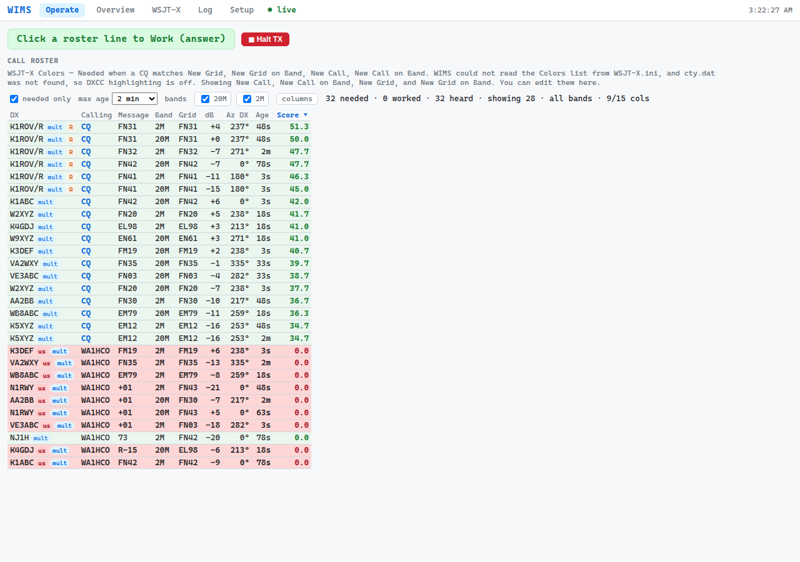

# WS Hub

WS Hub (formerly WIMS, the WSJT-X Instance Management System) is one console for a station running several copies of WSJT-X. It gathers every decode into one ranked **call roster**, marks what your goal still needs, and lets one operator answer a station with a click. It works alongside N1MM Logger+, GridTracker, DX cluster spots, and rotators.

It is built for multi-multi VHF contesting (the ARRL VHF contests at W2SZ), and it is useful at home with one radio too: a contest, an award such as DXCC or VUCC, or just a checklist of what is worth working.

**A person starts every transmit.** WS Hub never calls CQ and never transmits on its own. Clicking a roster line answers a station that WSJT-X has already decoded; Enable TX and CQ stay in WSJT-X. It also keeps radios that share an antenna or band from transmitting at the same time.



*The Operate page (an October screenshot, before the WS Hub name and the Show menu).*

## Install

Download the newest release from **[GitHub Releases](https://github.com/wa1hco/WS-Hub/releases)**. The files are still named `wims-<version>-…`.

- **Linux:** unpack the `.tar.gz` anywhere, open **scripts**, and double-click **Install WS Hub**. If the file manager asks, choose **Allow Launching** (or Execute, or Run). WS Hub copies itself to `~/.local/share/ws-hub`; delete the download, then double-click **WS Hub**.
- **Windows:** extract the `.zip` to `C:\WIMS`, open `scripts\windows`, and double-click **Install-Wims.cmd**. Then double-click **WS Hub** on the Desktop.

Step by step, with what to do when the desktop asks a question: **[INSTALL.md](INSTALL.md)**. Updates come from the **Updates** list in the WS Hub window.

## What it does today

- **Call roster** on the Operate page: every decode from every WSJT-X, ranked by score, with Country, distance, and heading. A badge says why a station is needed (grid, state, DXCC, CQ zone, ITU zone, continent, or call); in a contest it says **mult**. Click a line to **Work** that station in the WSJT-X that heard it; **Halt TX** stops what your console started.
- **Goals:** a contest, an award (DXCC, Worked All States, VUCC), a checklist, or your own list, checked against the log you choose. WS Hub reads logs and never changes them.
- **Spotted:** DX cluster spots the goal still needs, on any band, filtered by mode (SSB, CW, FT8, FT4, Other). A spot on a band with no WSJT-X running is marked **QSY**. A click selects the station; it does not retune or transmit yet.
- **Headings:** from the grid when one is known; otherwise an approximate heading from the station's country, marked `~`. WS Hub never guesses a grid square.
- **N1MM:** digital contacts go into N1MM, and N1MM's log decides dupes and mults.
- **Transmit interlock:** radios in one group never transmit together, and an SSB/CW key line can hold a patched WSJT-X off the air.
- **Rotators:** headings are read through hamlib `rotctld`.

What is planned and not built yet (for example, a spot click that retunes the radio and points the antenna) is in **[the build status](docs/plan/wims_status.md)**.

## Documentation

| For | Read |
|--|--|
| Installing | [INSTALL.md](INSTALL.md) |
| Using the console | [User manual](docs/User-manual.md) |
| Setting up WSJT-X, N1MM, and the key line | [Operator setup](docs/operator_setup.md) |
| Trying it at home, step by step | [Tester quick start](docs/tester_quickstart.md) · [What each piece is](docs/tester_roles.md) |
| Every file you can double-click | [scripts/README.md](scripts/README.md) |
| Networking a multi-PC station | [Networking](docs/plan/wims_networking.md) |
| How it is designed, and what is built | [Design](docs/plan/wims_design.md) · [Build status](docs/plan/wims_status.md) |
| What changed in each version | [Release notes](docs/releases/) |

Inside the program, the code, folders, and files still use the old name `wims` (for example `src/wims` and `C:\WIMS`). That is expected.

## Developer

For people changing WS Hub. Operators use the desktop icon.

WS Hub is plain Python 3.10+ with no packages to install. From a clone of [wa1hco/WS-Hub](https://github.com/wa1hco/WS-Hub):

```bash
python3 -m wims version
python3 -m wims solo --no-open
tools/dev/validate.sh        # the same checks CI runs
```

On a Mac there is no double-click installer; from the folder run `scripts/add-wims-to-desktop.sh`. Cutting a release: [INSTALL.md](INSTALL.md#cut-a-release-maintainers).

## License

WS Hub is free software under the **GNU General Public License v3.0 or later** (GPL-3.0-or-later). See [LICENSE](LICENSE).

    Copyright (C) 2026 Jeff Millar, WA1HCO
