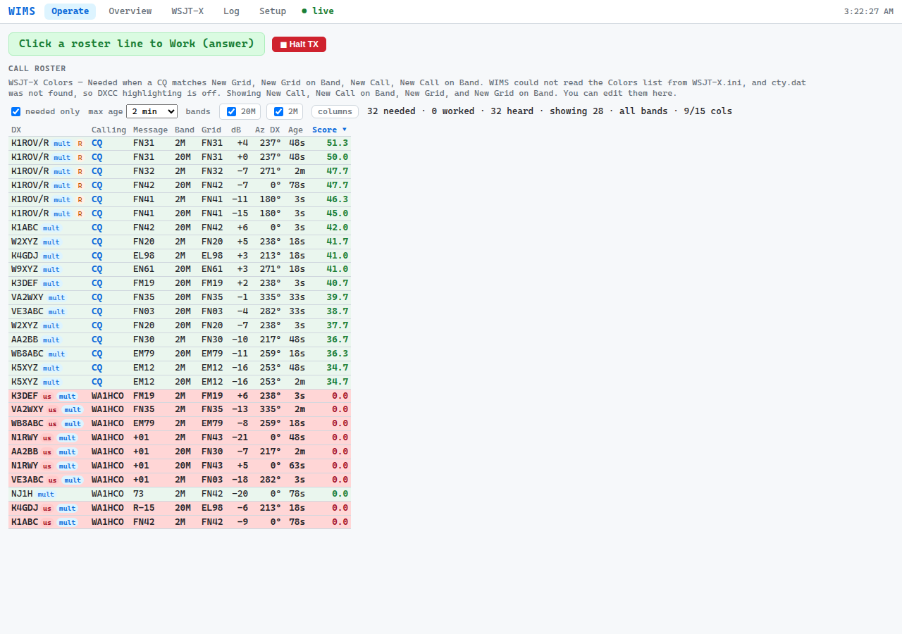
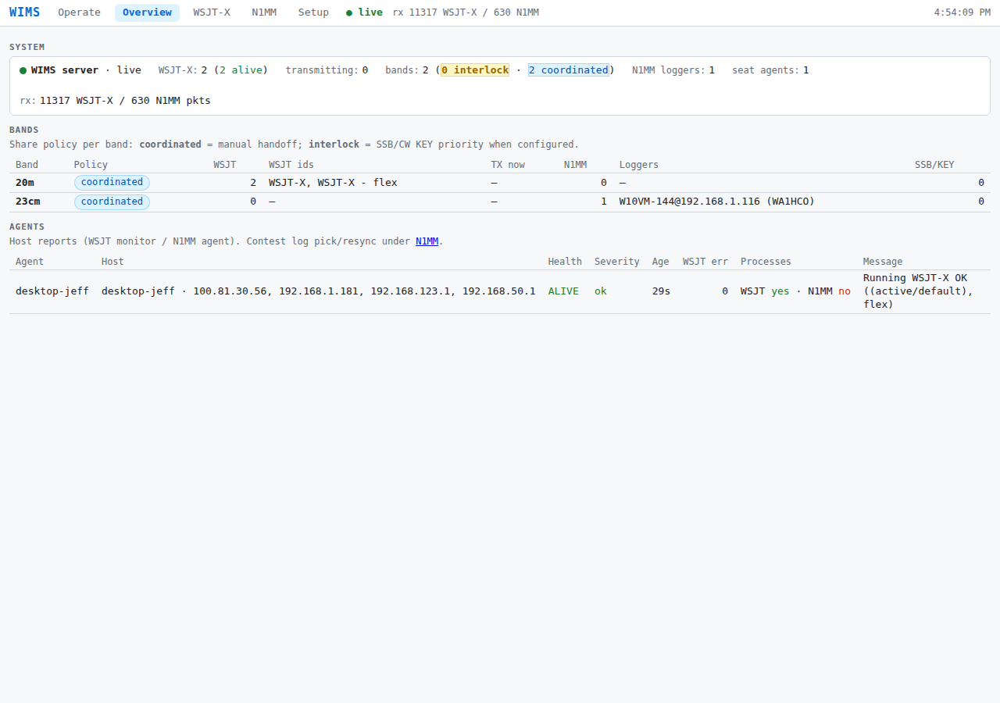
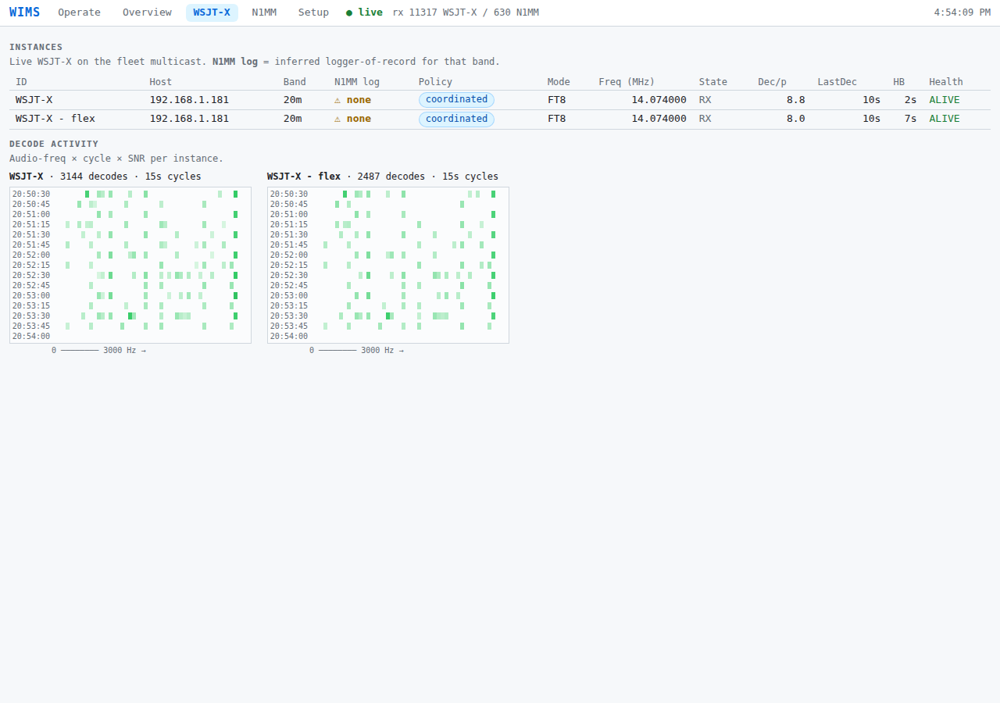
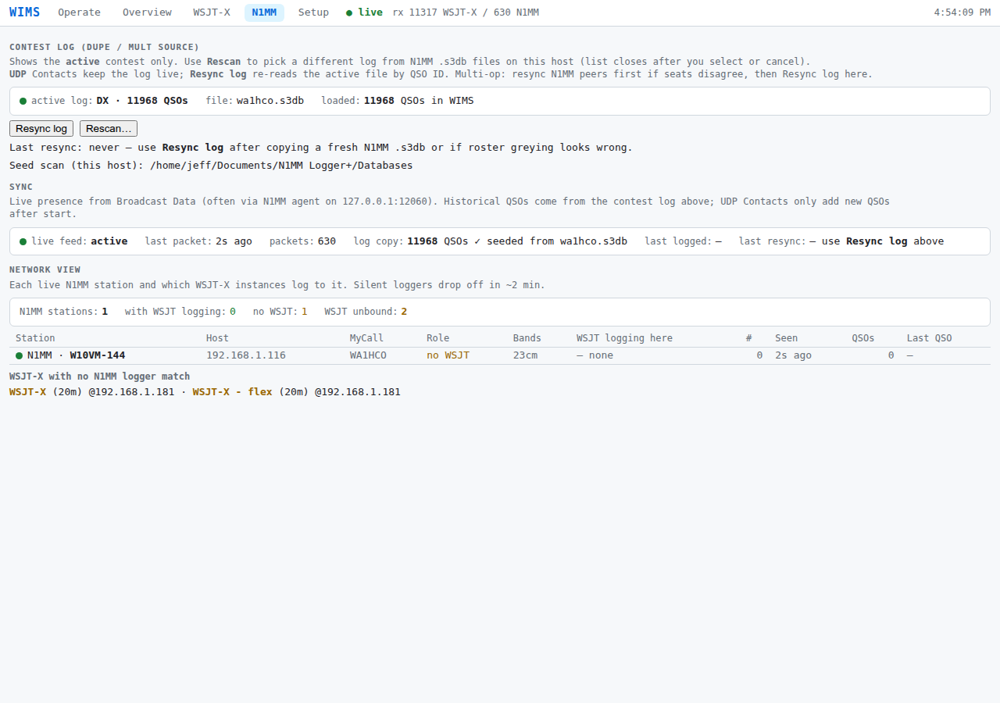
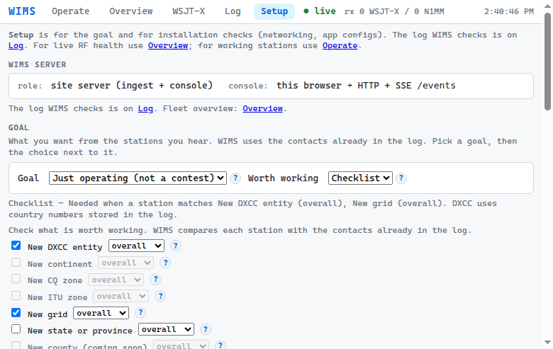
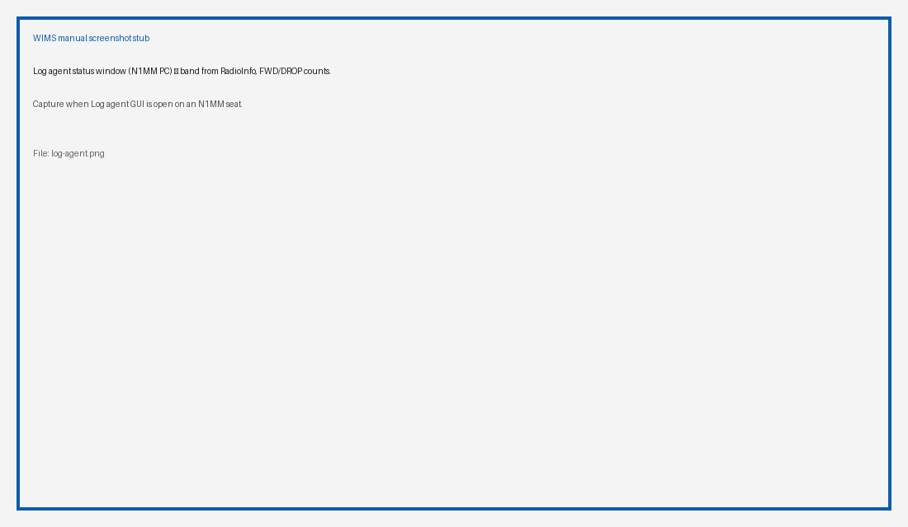
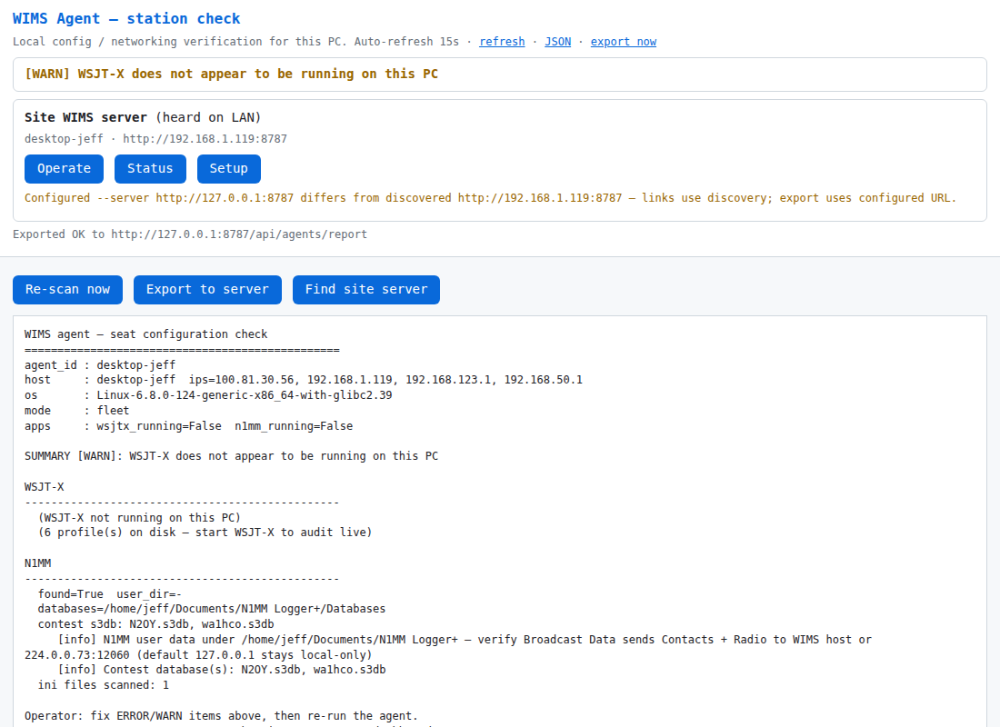
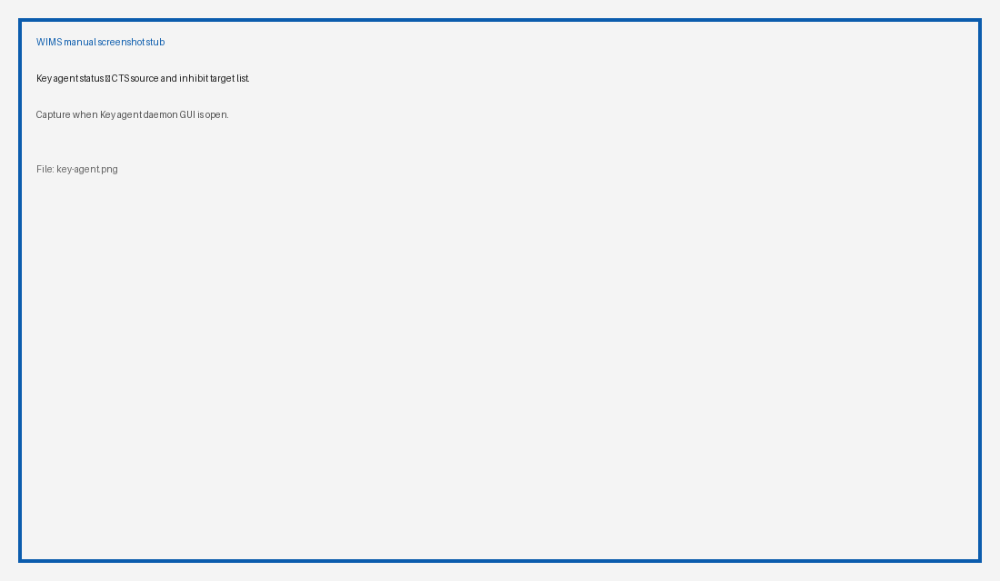

# WS Hub — User Manual

WS Hub was called WIMS (WSJT-X Instance Management System) before version 1.0.18. Some page titles, folders, and files still say WIMS or `wims`.

**Audience:** contest operators and seat wranglers (W2SZ multi-multi VHF and similar).  
**Install:** [INSTALL.md](../INSTALL.md).  
**Setup how-to (WSJT-X · N1MM · Keyline):** **[operator_setup.md](operator_setup.md)**.  
**Screenshots:** refresh with `tools/dev/capture-user-manual-shots.sh` (see [manual/README.md](manual/README.md)).  
**Related:** [tester_quickstart.md](tester_quickstart.md), [plan/wims_design.md](plan/wims_design.md), [plan/wims_networking.md](plan/wims_networking.md).

---

## What WS Hub is for

WS Hub is built for **multi-multi contesting**. The launch application is the **ARRL VHF/UHF contest**, but the same patterns apply wherever several WSJT-X instances and loggers share a LAN.

Contesting today is dominated by WSJT-X digital modes, while **SSB and CW** still matter. The usual practice is to switch between FT8 and SSB/CW rather than run both at once. That creates problems:

- Missed contacts in the mode not currently in use
- Time-consuming mode switches

At W2SZ we have learned that **FT8 can decode between SSB/CW transmissions** — call it **FT8 break-in**. The scenario: a second radio listens on the band’s FT8 frequency while the SSB/CW station calls CQ or works search-and-pounce.

### Preferred minimal FT8 break-in setup

- SSB/CW radio plus a second FT8 radio
- Receive split and routed to both radios
- Transmit paths through a selection relay
- KEY line from one radio controls the selection relay
- **WS Hub keeps the two radios from transmitting at the same time**

To minimize SSB/CW workload, the FT8 radio listens continuously and reports **needed** decodes to a **call roster**. The SSB/CW operator can start WSJT-X answering a station by **clicking a roster line**. The station has to be in that WSJT-X's own decodes; WS Hub cannot start a contact with a station WSJT-X has not heard.

What’s new: the SSB/CW operator can keep calling CQ or answering S&P while WSJT-X works and logs a station. Interrupting the FT8 transmitter (via inhibit) is like losing pieces of a received signal — decoding at the DX end often still succeeds.

That overlap is the **inhibit** path: a beta/patched WSJT-X releases PTT when another radio’s KEY asserts (**TxInhibit type 18**).

### What WS Hub does today

1. **Call roster** — needed stations; click to **Work** (answer)  
2. **Inhibit** — SSB/CW KEY → WSJT-X PTT release (N1MM agent **KEY** section + Keyline)  
3. **Logging** — WSJT-X Logged QSOs → N1MM via **N1MM agent Log**  
4. **Broadcast bridge** — N1MM Broadcast Data on localhost → site **N1MM** tab via **N1MM agent Broadcast**
5. **Spotted** — DX cluster spots the Goal still needs, including other bands, filtered by mode. A click selects the station. It does not transmit and it does not retune a radio.  
6. **Headings** — Az DX from the grid, or an approximate heading from the station's country (marked `~`) when no grid is known. No grid square is ever guessed.  
7. **Rotators** — headings read from hamlib `rotctld` on the seat, shown on Operate.

**Planned, not built:** a Spotted click that retunes the radio over CAT and points the antenna. The contact still starts from the call roster once that WSJT-X decodes the station.

---

## Quick start

- **Install:** [INSTALL.md](../INSTALL.md). Then double-click **WS Hub** on the desktop.
- **Console:** `http://<server>:8787/`. The WS Hub window opens it as an app window with Chrome, Chromium, or Edge, or a dedicated resizable Firefox window; otherwise it uses the normal default browser.
- **Updates:** the button at the top of the WS Hub window, or the **Updates** list. An update is never installed in the middle of a contact; it waits until you click **Install update** or **Install this update**.

**Exact app settings:** [operator_setup.md](operator_setup.md).

The launcher has **Running on this PC** (live) and **This seat will run** (remembered intent):

| Intent | Starts |
|--------|--------|
| **N1MM** | **N1MM agent** — Broadcast + Log |
| **SSB/CW KEY** | same agent with **KEY** (pick KEY COM/tty in the launcher) |
| **WSJT-X** | WSJT monitor agent (`:8790`) |
| **Site server** | Fleet console (`:8787`) — one per LAN |

---

## Site console

One **site server** per contest LAN. Top nav:

**Operate · Overview · WSJT-X · N1MM · Setup**

### Operate (call roster)



*Operate — call roster. Click a line to Work (answer); Halt TX stops QSOs this console started. Call CQ in WSJT-X.*

- Needs: WSJT multicast + N1MM contest log (seed and/or live Contacts via agent).  
- Hover the **Call roster** heading (dotted underline) for the goal's rules in one line.
- **Work** = answer that station. **CQ / run** = WSJT-X UI only.
- **Halt TX** = stop Work started from **this** browser. Other operators’ QSOs and local WSJT-X CQ are left running. If this console started two bands, Halt stops both.
- **Message**, next to Calling, is the rest of that decode: a report such as R-12, a sign-off such as 73, a grid, or the leftover text of a QSY. Hover the cell for the whole line. A long line is shortened on the row.
- **Show** is Needed, Needed and CQ, Needed and CQ or 73, or All. Hover an item for what it keeps. The choice stays in this browser.
- When the badge names the place that is needed (grid, state, DXCC, and so on), the generic **mult** badge is left off, because that word already says why the row is there. In a contest, only **mult** shows.
- A tail-end often has no grid, as in `W1XX CX4BAN R-10`. WS Hub remembers the last grid it heard for that station and shows that square as the grid. Hover it (the dotted line) for the band and the time, such as `Grid from 20m at 14:10 UTC (GF15)`. A station that is not a rover stays in the grid it already gave. A rover is a call ending in `/R`, or a station heard in two different squares. The grid that rover sent earlier in this contact is also certain: this contact is the exchange with you, from your first message to them or their first message to you, including the call just before that. That square is shown as the grid. **grid assumed**, in italics, is only a rover square from an earlier hearing. Check that one before you log. A rover's grid is filled only when it was heard in the last 10 minutes; otherwise the cell stays blank and the hover says why. **Az DX** is the heading from your grid to that station. If no grid is known, it may show an approximate heading from the station's country in the country file, marked with a tilde, and the Grid cell stays blank. Work never sends that country location as a grid. Work sends the square to the WSJT-X you are working, so its DX Grid box and the logged contact can carry it. WS Hub does not change the WSJT-X log file. If that station sends a grid while the contact is still open, the roster and WSJT-X take the new square. The record says **grid remembered** only when a rover's square came from an earlier hearing. A fixed station, and a rover square from this contact, are logged as the grid with no extra comment.

**TX groups** (under the roster) stays off a simple station. A group is a set of WSJT-X instances that must not transmit at the same time. Hover the **TX groups** label for that sentence. WS Hub still refuses Work when another instance in the group already holds TX — this block only changes what you see.

What is on the page:

| Situation | What you see |
|-----------|----------------|
| Each instance is in its own group, nothing is blocked, no overlap, Work has not been refused | Nothing. No heading, no banner, no table. A station with two bands and a second radio looks like this when those radios do not share a group. |
| A group has more than one instance, and all of them are quiet | A closed **TX groups** line. Open it for the table (who is in the group, who is transmitting). |
| Two transmitters in one group right now | A red line **Overlap: 20M** (the group name, written the same way as other band labels). **TX groups** opens so the table is on screen. You can close it; the red line stays. |
| Work was refused, another instance in the group holds TX, or one of several instances in a group is transmitting | A red line **Work blocked: 20M is transmitting**. **TX groups** is there, closed, if you want the table. |
| An overlap happened earlier and has stopped | The line stays as **Overlap: 20M** (amber, not flashing) until the site server is restarted, so it is not only inside a closed list. Open **TX groups** for how long ago and which instances. |

A group with more than one instance is the multi-op case: the closed **TX groups** line is how you reach the table even when nothing is wrong.

**Spotted**, under the roster, is a DX cluster list. It is not the live roster. Each line is one station on one band: call, grid, band, mode, frequency, **QSY** or **on band**, why it is needed, score, age, and how many stations spotted it. **On band** means a WSJT-X you already have running is on that band and that mode. **QSY** means it is not, so you would move a radio if the spot is worth it. The line stays either way. Spots that are already worked, or that have a grid and are too far for that band, are left off. Under a grid-only Goal such as VUCC, a spot with no grid is also left off. Under a DXCC or checklist Goal that can need a station without a grid, that spot stays. **Az DX** then shows an approximate heading from the country in the country file, marked with a tilde (`~260°`); hover it for the explanation. The Grid cell stays blank — WS Hub does not invent a square from the country. Distance to that country is not used to drop the spot as out of range. They drop off after 15 minutes.

Under the heading, checkboxes for **SSB**, **CW**, **FT8**, **FT4**, and **Other** hide spots that are not that mode. All start on. **Other** is MSK144, Q65, FM, data, and anything else. The choice is kept with the cluster settings. The count on the status line follows the boxes. The **mult** badge on a Spotted line follows the same rule as the call roster: it is left off when the place word is shown, and in a contest only **mult** shows.

The line above the list is the connection, such as `Cluster: logged in, 12 spots, 3 needed`. Hover it for the node, the login, and why some spots were left off. A failure names the next step. Spots stay off until Setup turns them on (`Cluster: off. Turn it on in Setup.`).

Click a Spotted line to select that station. The radio is not retuned and nothing is transmitted. Work still needs a live decode on the roster. (Retuning the radio and pointing the antenna from a spot is planned. Even then, the contact starts from the roster after WSJT-X decodes the station.)

### Overview · WSJT-X · Log · N1MM

| Page | URL | Content |
|------|-----|---------|
| **Overview** | `/overview` | System, bands, agents, rotators |
| **WSJT-X** | `/wsjt` | Digi instances + decode activity heatmaps |
| **Log** | `/log` | Which log counts, count-since, resync, Check logs |
| **N1MM** | `/n1mm` | Several N1MM stations at once (hidden when there is only one) |

(`/status` still opens Overview.)







### Setup



*Setup — Goal and install diagnostics (networking, seat configs). The log is on **Log**.*

**Goal** is Contest, Award, Just operating, or Custom. Just operating uses **Checklist**. Tick what is worth working. Each line counts the first time, on each band, or on each mode. Continent, CQ zone, and ITU zone use the country list WSJT-X already keeps. When that list is not on this computer, those three lines stay off and the tip says so. County and callsign prefix stay off. A choice saved earlier as WSJT-X Colors is turned into the matching checklist lines the next time WS Hub starts, and that list is what Setup shows after that. The log under **Log to use** is the only log those lines read.

**DX cluster** is under the Goal. **Show spots** turns the list on. It is off until you check it. The usual node is K1TTT (`k1ttt.net`, port 7373). The list also has NC7J, W3LPL, and VE7CC, or you can type another host and port. WS Hub logs in with the callsign from WSJT-X and then only listens. It does not post spots. **QSY cost** is how many points a spot loses when no radio is already on that band and mode. The usual cost is 8. The spot stays on the list. **All bands** starts checked, so a spot on another band can show. Uncheck a band to hide it. Save is immediate when you change a box. The choice is kept on this PC the same way the Goal is.

The line on Operate tells you what the node is doing. **connected, no spots yet** means the connection is up and the node has not sent a spot. **logged in, no spots yet** means your callsign was sent. **logged in, 12 spots, 3 needed** means spot lines arrived. If the node accepts the connection and stays silent, the line says the node sent nothing and to try another node. Hover that line for how long since the last spot.

---

## N1MM agent (logger / SSB-CW PC)

In the WS Hub window, check **N1MM** and **SSB/CW KEY**.

| Section | Job |
|---------|-----|
| **Log** | Fleet digi Logged QSOs (`224.0.0.73:2237`) → local N1MM (`:52001` / `:2333`). A blank grid is filled from the last grid WS Hub heard, and the comment says the grid was remembered. The WSJT-X log can still show it blank. |
| **Broadcast** | Hear N1MM **Broadcast Data** on `127.0.0.1:12060` → site `/api/n1mm/broadcast` |
| **KEY** | Keyline CTS → same-band type-18 holds |

**N1MM Configurer:** Broadcast Data **Radio + Contacts → `127.0.0.1:12060`**.  
**WSJT/JTDX UDP reader → OFF** (the agent Log section replaces it).  
The agent finds the site server on the LAN by itself. If it does not, put the site address in the WS Hub window under **Other tools…** (site URL). This is not N1MM networking port **12070**.



*N1MM agent status window (Broadcast / Log / KEY).*

---

## WSJT monitor (digi PC)

Optional. Launcher **WSJT-X** intent → local UI `http://127.0.0.1:8790/` and rows under Overview **Agents**.



*WSJT monitor — config check for instances on this PC.*

---

## Inhibit / Keyline

- Pick **KEY device** in the launcher (COM / `/dev/tty…` / `sim:up`).  
- Hardware: [tools/hardware/keyline_interface/](../tools/hardware/keyline_interface/) · flash: [eeprom/README.md](../tools/hardware/keyline_interface/eeprom/README.md).  
- Digi needs patched WSJT-X (type **18** hold; port **22372** or ephemeral via InhibitStatus).  



*KEY section — CTS and targets.*

Design: [plan/wims_key_agent.md](plan/wims_key_agent.md), [protocols/wsjtx_tx_inhibit.md](protocols/wsjtx_tx_inhibit.md).

---

## Networking (short)

Authoritative: [plan/wims_networking.md](plan/wims_networking.md).

| Plane | Address |
|-------|---------|
| WSJT fleet UDP | **`224.0.0.73:2237`** (all bands; unique `--rig-name` per instance) |
| N1MM Broadcast (fleet) | **`127.0.0.1:12060`** → N1MM agent → site |
| N1MM↔N1MM mesh | **12070** (not WS Hub) |
| Site HTTP | **:8787** |
| WSJT monitor | **:8790** on that PC |

---

## Dial frequency

The WSJT-X and N1MM dial is taken as the real radio frequency. A Flex at 28.074 MHz shows as **10m**. Only a radio that reports an IF (a transverter, such as 222 MHz on a 21 MHz IF or 432 MHz on a 28 MHz IF) needs marking: mark that rig name on **Setup**, or on the seat page on that PC.

---

## Safety

- **Zero TX overlap** per resource group; fail-safe to RX.  
- **No automated or unattended transmit** — a person starts every transmit. CQ and Enable TX stay in WSJT-X.  
- Restarting the launcher **replaces** N1MM agent / WSJT monitor but **leaves the site server alone**.  

---

## Keeping screenshots current

**Launcher → Other tools… → Screenshots…** (select pages, standard name or suffix), or:

```bash
tools/dev/capture-user-manual-shots.sh
tools/dev/capture-user-manual-shots.sh --suffix contest_run
```

See [manual/README.md](manual/README.md). Catalog: [manual/shots.json](manual/shots.json).  
Images: [manual/images/](manual/images/) — Markdown paths stay fixed when you refresh.

---

## Document history

| Date | Note |
|------|------|
| 2026-11-12 | WS Hub name; install moved to INSTALL.md; Call roster tooltip; headings, rotators, and planned spot retune listed |
| 2026-11-11 | Hide a redundant mult badge on the call roster too, when a place word is shown |
| 2026-11-10 | Spotted mode checkboxes, and hide a redundant mult badge |
| 2026-10-28 | DX cluster node list. Usual node is K1TTT. A silent node says so |
| 2026-10-27 | Operate Spotted list and Setup DX cluster (other bands, QSY cost, click does not transmit) |
| 2026-10-19 | Operate TX groups: hidden until a shared group or a conflict; one-line banner |
| 2026-08-30 | Initial Markdown manual + screenshot manifest |
| 2026-09-05 | N1MM agent Broadcast/Log/KEY; console Overview/WSJT/N1MM; link operator_setup |
| 2026-09-05 | Screenshots panel (map144-style); overview/wsjt/n1mm embeds |
