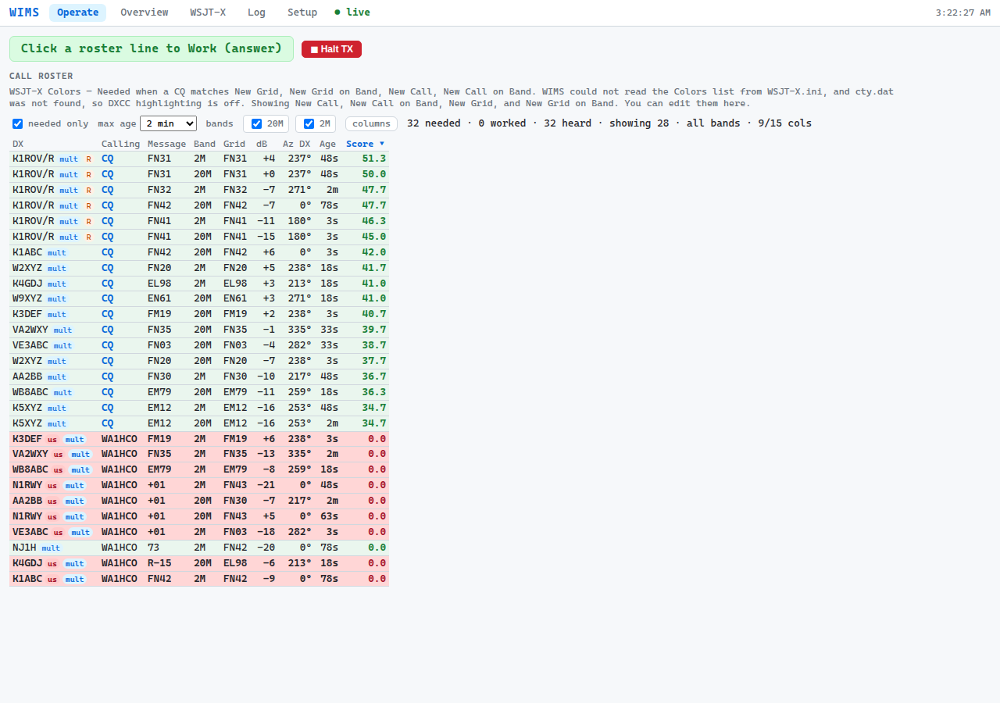
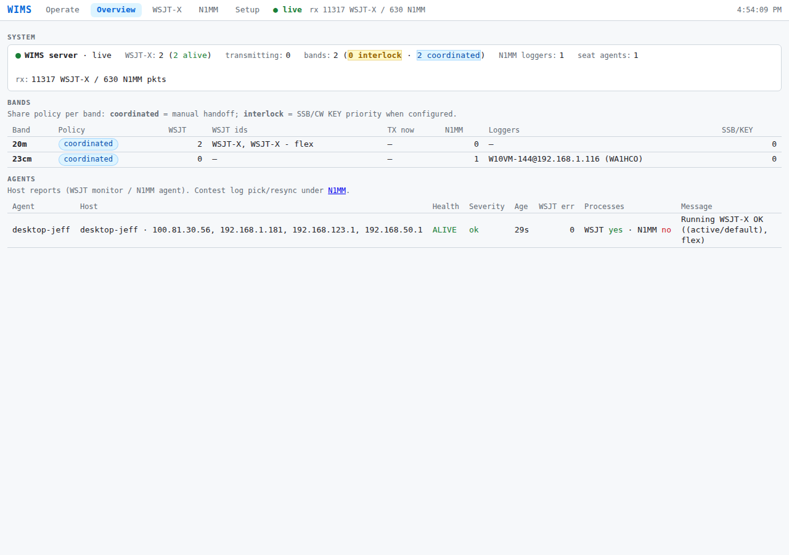
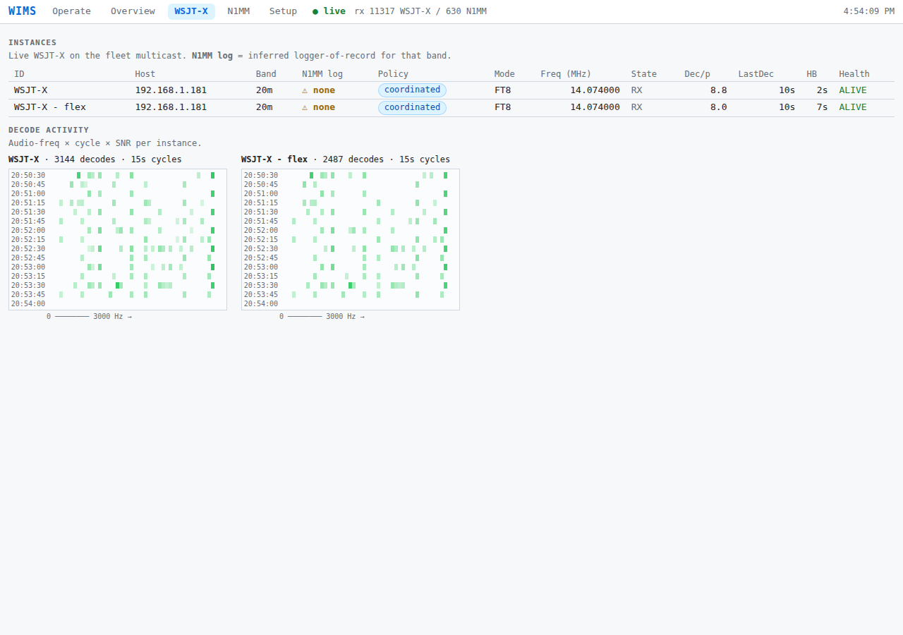
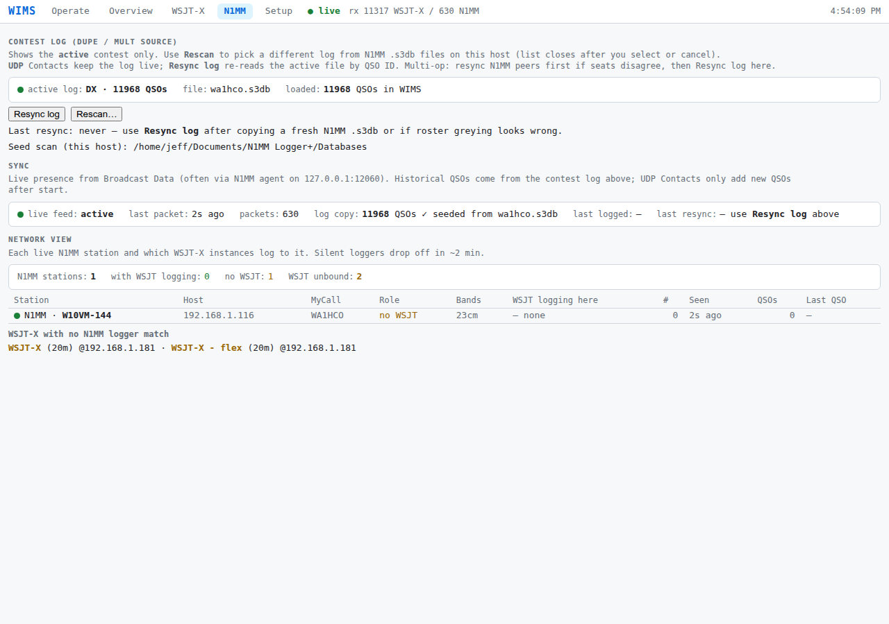
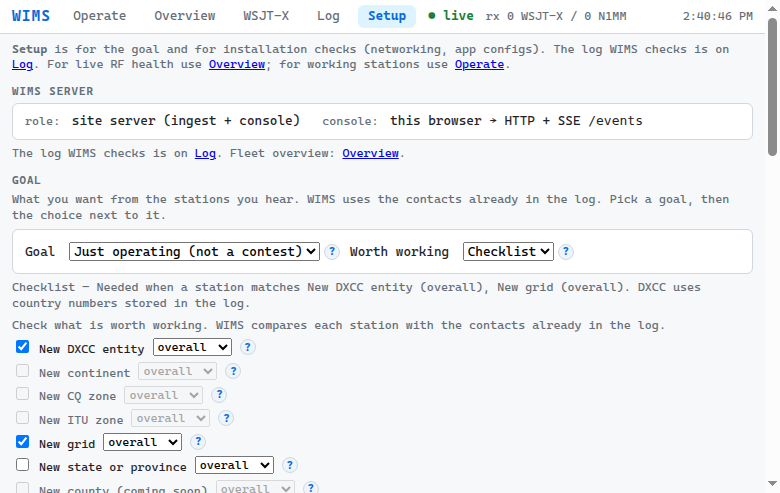
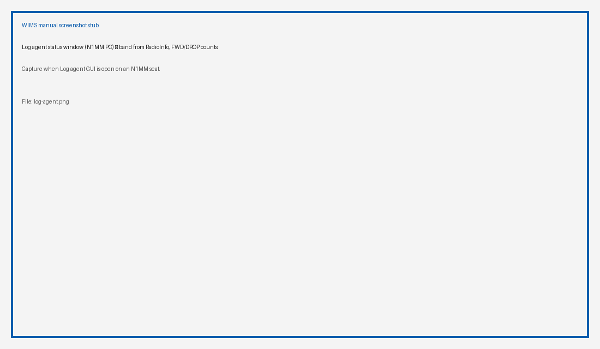
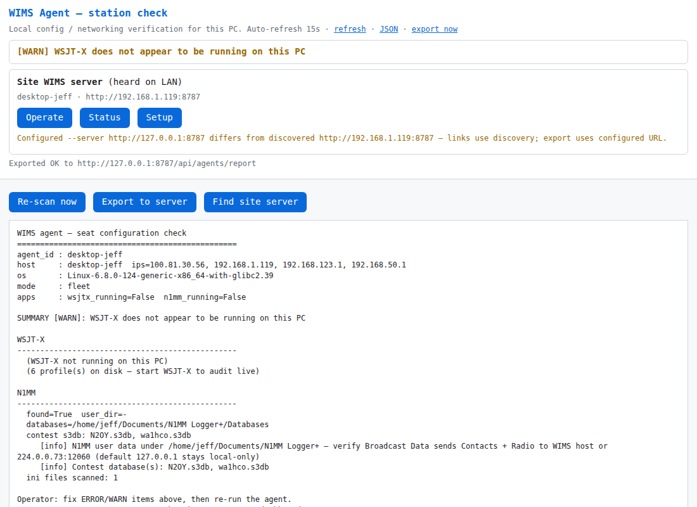
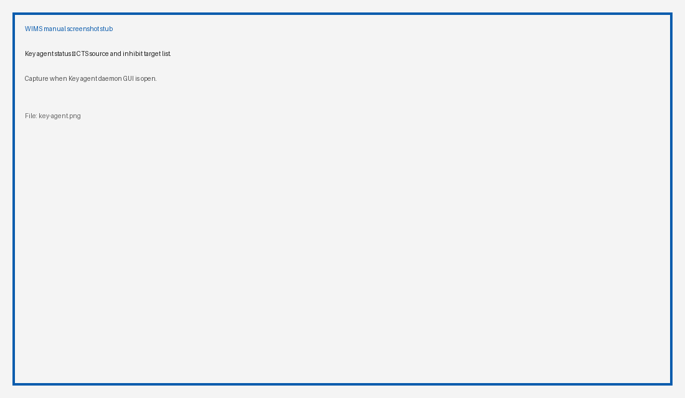

# WSJT-X Instance Management System (WIMS) — User Manual

**Audience:** contest operators and seat wranglers (W2SZ multi-multi VHF and similar).  
**Setup how-to (WSJT-X · N1MM · Keyline):** **[operator_setup.md](operator_setup.md)** ← start here for install/config.  
**Screenshots:** refresh with `tools/dev/capture-user-manual-shots.sh` (see [manual/README.md](manual/README.md)).  
**Related:** [tester_quickstart.md](tester_quickstart.md), [plan/wims_design.md](plan/wims_design.md), [plan/wims_networking.md](plan/wims_networking.md).

---

## What WIMS is for

WIMS is built for **multi-multi contesting**. The launch application is the **ARRL VHF/UHF contest**, but the same patterns apply wherever several WSJT-X instances and loggers share a LAN.

Contesting today is dominated by WSJT-X digital modes, while **SSB and CW** still matter. The usual practice is to switch between FT8 and SSB/CW rather than run both at once. That creates problems:

- Missed contacts in the mode not currently in use
- Time-consuming mode switches

At W2SZ we have learned that **FT8 can decode between SSB/CW transmissions** — call it **FT8 break-in**. The scenario: a second radio listens on the band’s FT8 frequency while the SSB/CW station calls CQ or works search-and-pounce.

### Preferred minimal FT8 break-in setup

- SSB/CW radio plus a second FT8 radio
- Receive split and routed to both radios
- Transmit paths through a selection relay
- KEY line from one radio controls the selection relay
- **WIMS keeps the two radios from transmitting at the same time**

To minimize SSB/CW workload, the FT8 radio listens continuously and reports **needed** decodes to a **call roster**. The SSB/CW operator can start WSJT-X working a station by **clicking a roster line**.

What’s new: the SSB/CW operator can keep calling CQ or answering S&P while WSJT-X works and logs a station. Interrupting the FT8 transmitter (via inhibit) is like losing pieces of a received signal — decoding at the DX end often still succeeds.

That overlap is the **inhibit** path: a beta/patched WSJT-X releases PTT when another radio’s KEY asserts (**TxInhibit type 18**).

### WIMS functions today

1. **Call roster** — needed stations; click to **Work** (answer)  
2. **Inhibit** — SSB/CW KEY → WSJT-X PTT release (N1MM agent **KEY** section + Keyline)  
3. **Logging** — WSJT-X Logged QSOs → N1MM via **N1MM agent Log**  
4. **Broadcast bridge** — N1MM Broadcast Data on localhost → site **N1MM** tab via **N1MM agent Broadcast**  

---

## Quick start

- **Windows:** double-click `scripts\Add WIMS to Desktop.bat`, then Desktop **WIMS**. First time: `Install-Wims.cmd` — [scripts/windows/README.md](../scripts/windows/README.md)
- **Linux:** `./scripts/add-wims-to-desktop.sh` (needs `python3-tk`), then double-click **WIMS**  
- Console: `http://<server>:8787/` (the WIMS launcher opens it as a chrome-free
	app window with Chrome, Chromium, or Edge, or a dedicated resizable Firefox
	window; otherwise it uses the normal default browser)  

**Exact app settings:** [operator_setup.md](operator_setup.md).

The launcher has **Running on this PC** (live) and **This seat will run** (remembered intent):

| Intent | Starts |
|--------|--------|
| **N1MM** | **N1MM agent** — Broadcast + Log |
| **SSB/CW KEY** | same agent with **KEY** (pick KEY COM/tty in the launcher) |
| **WSJT-X** | WSJT monitor agent (`:8790`) |
| **Site server** | Fleet console (`:8787`) — one per LAN |

### Install / update (Windows)

1. Tree on disk (`git clone` or copy).  
2. **`scripts\windows\Install-Wims.cmd`** once.  
3. Day-to-day: Desktop **WIMS**.  
4. When offered: **Update WIMS** (does not auto-pull mid-contact).  

---

## Site console

One **site server** per contest LAN. Top nav:

**Operate · Overview · WSJT-X · N1MM · Setup**

### Operate (call roster)



*Operate — call roster. Click a line to Work (answer); Halt TX stops QSOs this console started. Call CQ in WSJT-X.*

- Needs: WSJT multicast + N1MM contest log (seed and/or live Contacts via agent).  
- **Work** = answer that station. **CQ / run** = WSJT-X UI only.
- **Halt TX** = stop Work started from **this** browser. Other operators’ QSOs and local WSJT-X CQ are left running. If this console started two bands, Halt stops both.
- **Message**, next to Calling, is the rest of that decode: a report such as R-12, a sign-off such as 73, a grid, or the leftover text of a QSY. Hover the cell for the whole line. A long line is shortened on the row.
- A tail-end often has no grid, as in `W1XX CX4BAN R-10`. WIMS remembers the last grid it heard for that station and shows it on the roster in italics. Hover the grid for when and on what band it was heard. When that contact is logged with a blank grid, the record WIMS keeps and the record it sends to the logger include the remembered grid. The WSJT-X log may still show the grid blank. WIMS does not change the WSJT-X log file. A rover's grid is filled only when it was heard in the last 30 minutes; otherwise the cell stays blank and the hover says why.

**TX groups** (under the roster) stays off a simple station. A group is a set of WSJT-X instances that must not transmit at the same time. Hover the **TX groups** label for that sentence. WIMS still refuses Work when another instance in the group already holds TX — this block only changes what you see.

What is on the page:

| Situation | What you see |
|-----------|----------------|
| Each instance is in its own group, nothing is blocked, no overlap, Work has not been refused | Nothing. No heading, no banner, no table. A station with two bands and a second radio looks like this when those radios do not share a group. |
| A group has more than one instance, and all of them are quiet | A closed **TX groups** line. Open it for the table (who is in the group, who is transmitting). |
| Two transmitters in one group right now | A red line **Overlap: 20M** (the group name, written the same way as other band labels). **TX groups** opens so the table is on screen. You can close it; the red line stays. |
| Work was refused, another instance in the group holds TX, or one of several instances in a group is transmitting | A red line **Work blocked: 20M is transmitting**. **TX groups** is there, closed, if you want the table. |
| An overlap happened earlier and has stopped | The line stays as **Overlap: 20M** (amber, not flashing) until the site server is restarted, so it is not only inside a closed list. Open **TX groups** for how long ago and which instances. |

A group with more than one instance is the multi-op case: the closed **TX groups** line is how you reach the table even when nothing is wrong.

### Overview · WSJT-X · Log · N1MM

| Page | URL | Content |
|------|-----|---------|
| **Overview** | `/overview` | System, bands, agents, rotators |
| **WSJT-X** | `/wsjt` | Digi instances + decode activity heatmaps |
| **Log** | `/log` | Which log counts, count-since, resync, Check logs |
| **N1MM** | `/n1mm` | Several N1MM stations at once (hidden when there is only one) |

(`/status` still opens Overview.)







### Setup



*Setup — goal and install diagnostics (networking, seat configs). The log is on **Log**.*

---

## N1MM agent (logger / SSB-CW PC)

In the WIMS window, check **N1MM** and **SSB/CW KEY**.

| Section | Job |
|---------|-----|
| **Log** | Fleet digi Logged QSOs (`224.0.0.73:2237`) → local N1MM (`:52001` / `:2333`). A blank grid is filled from the last grid WIMS heard, and the comment says the grid was remembered. The WSJT-X log can still show it blank. |
| **Broadcast** | Hear N1MM **Broadcast Data** on `127.0.0.1:12060` → site `/api/n1mm/broadcast` |
| **KEY** | Keyline CTS → same-band type-18 holds |

**N1MM Configurer:** Broadcast Data **Radio + Contacts → `127.0.0.1:12060`**.  
**WSJT/JTDX UDP reader → OFF** (the agent Log section replaces it).  
Set `WIMS_SERVER=http://<site>:8787`. Not N1MM networking port **12070**.



*N1MM agent status window (Broadcast / Log / KEY).*

---

## WSJT monitor (digi PC)

Optional. Launcher **WSJT-X** intent → local UI `http://127.0.0.1:8790/` and rows under Overview **Agents**.



*WSJT monitor — config check for instances on this PC.*

---

## Inhibit / Keyline

- Pick **KEY device** in the launcher (COM / `/dev/tty…` / `sim:up`).  
- Hardware: [hardware/keyline_interface/](../hardware/keyline_interface/) · flash: [eeprom/README.md](../hardware/keyline_interface/eeprom/README.md).  
- Digi needs patched WSJT-X (type **18** hold; port **22372** or ephemeral via InhibitStatus).  



*KEY section — CTS and targets.*

Design: [plan/wims_key_agent.md](plan/wims_key_agent.md), [protocols/wsjtx_tx_inhibit.md](protocols/wsjtx_tx_inhibit.md).

---

## Networking (short)

Authoritative: [plan/wims_networking.md](plan/wims_networking.md).

| Plane | Address |
|-------|---------|
| WSJT fleet UDP | **`224.0.0.73:2237`** (all bands; unique `--rig-name` per instance) |
| N1MM Broadcast (fleet) | **`127.0.0.1:12060`** → N1MM agent → site |
| N1MM↔N1MM mesh | **12070** (not WIMS) |
| Site HTTP | **:8787** |
| WSJT monitor | **:8790** on that PC |

---

## Safety

- **Zero TX overlap** per resource group; fail-safe to RX.  
- **No automated/unattended transmit** — human initiates TX.  
- Restarting the launcher **replaces** N1MM agent / WSJT monitor but **leaves the site server alone**.  

---

## Keeping screenshots current

**Launcher → Other tools… → Screenshots…** (select pages, standard name or suffix), or:

```bash
tools/dev/capture-user-manual-shots.sh
tools/dev/capture-user-manual-shots.sh --suffix contest_run
```

See [manual/README.md](manual/README.md). Catalog: [manual/shots.json](manual/shots.json).  
Images: [manual/images/](manual/images/) — Markdown paths stay fixed when you refresh.

---

## Document history

| Date | Note |
|------|------|
| 2026-10-19 | Operate TX groups: hidden until a shared group or a conflict; one-line banner |
| 2026-08-30 | Initial Markdown manual + screenshot manifest |
| 2026-09-05 | N1MM agent Broadcast/Log/KEY; console Overview/WSJT/N1MM; link operator_setup |
| 2026-09-05 | Screenshots panel (map144-style); overview/wsjt/n1mm embeds |
